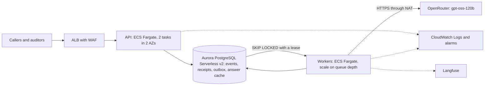

# AWS design: the validator as a small, authenticated service

On paper only: nothing here is deployed. It sizes the service built in iterations 3 and 4 (an API,
a worker and a database) for about **50,000 receipts a day**, and answers the five questions of
the brief's Part 4. Prices are AWS list prices, US East (N. Virginia), read from the AWS pricing
pages on 2026-10-11.

## 1. Architecture

- **API and compute: ECS Fargate**, stateless, behind an Application Load Balancer. A worker holds
  a database connection and makes 1 to 4 second model calls; Lambda would need a VPC, a NAT and a
  connection proxy for that, so Fargate is simpler at this size. The worker scales on the number of
  pending items in the outbox (a custom metric).
- **Database: Aurora PostgreSQL Serverless v2, Multi-AZ (proposed; the choice against DynamoDB
  is still open, see section 6).** The system's correctness rests on one
  transaction (event, projection and outbox row commit together) and on leased claims
  (`SELECT … FOR UPDATE SKIP LOCKED`). Postgres keeps both, so the move is one adapter behind the
  `ReceiptStore` port, with the same contract tests as SQLite. DynamoDB with SQS would also work
  but would have to rebuild that transaction; at 0.6 receipts a second it buys nothing yet. The
  classification cache moves from a file to a table keyed by the same hash.
- **Logs:** structured JSON to CloudWatch Logs with alarms on queue depth, failed receipts and
  model errors. Model calls stay traced in Langfuse; Langfuse never gates a request.

## 2. The policy documents

The nine documents are **code with tests**: every rule cites its policy sentence verbatim and a
test checks it. A policy update is a pull request, CI (unit, determinism and verbatim-evidence
tests), an image build and a rolling deployment. Every result records `rules_version`, so old
decisions stay explainable. A versioned S3 bucket archives each release's policy bundle for audit;
it is not read at run time, because rule code and policy text must change together.

## 3. Authentication and secrets

**Cognito**: auditors and Compliance sign in through the company identity provider (SAML or OIDC);
calling systems use client-credentials tokens. The API validates the JWT and takes the reviewer from
the token, not from free text (today's `actor`), with scopes for intake and for review actions.
**Secrets Manager** holds the OpenRouter key and the database credentials, injected into the task at
start through the task role. Neither enters the image, the repository or the logs (a pre-commit
hook blocks key patterns and failure reasons are scrubbed).

## 4. Cost at about 50,000 receipts a day

1.5 million receipts a month; 2.47 line items per receipt (79 lines in 32 receipts) gives 3.70
million items a month. Every figure below is arithmetic on a stated price or an assumption.

| Line | Arithmetic | USD a month |
|---|---|---|
| Model calls | 3.70 M items × 0.060824 per 1,000 (measured on the dev set, gpt-oss-120b); upper bound, no cache hits | 225 |
| Aurora compute | 2 ACU on average (writer about 1.5, reader 0.5) × 730 h × 0.12 | 175 |
| Aurora storage and I/O | 100 GB average (11 KB a receipt, measured) × 0.10, plus 150 M I/O × 0.20 per million (100 per receipt, assumed) | 40 |
| Fargate, API | 2 tasks × (0.5 vCPU × 0.0404784 + 1 GB × 0.004446) × 730 h | 36 |
| Fargate, workers | 5 tasks on average × (0.25 vCPU × 0.0404784 + 0.5 GB × 0.004446) × 730 h. A receipt takes about 3.7 s of classification, so 0.58 receipts a second keeps about 2 tasks busy and a 10× peak about 21 | 45 |
| Load balancer | 730 h × 0.0225, plus 1 LCU × 730 h × 0.008 | 22 |
| NAT gateway | 730 h × 0.045, plus about 11 GB × 0.045 (price from AWS's example for another US region) | 33 |
| Cognito | Employees inside the 10,000 free MAU; 10 systems × 24 tokens × 30 days × 0.00225 per token | 16 |
| Logs and secrets | 20 GB ingested × 0.50 (assumed volume), 0.60 storage; 2 secrets × 0.40 | 12 |
| **Total** | about USD 0.0004 a receipt | **≈ 605** |

Not included: Langfuse hosting, WAF rules, data transfer to users, a support plan and a
non-production environment. The model is 37 % of the total, and any cache hit lowers it. The
I/O line and the log volume are assumptions to measure first.

## 5. Before real receipts go through it

1. **Model outage and retries.** Today a provider failure leaves the receipt `failed` and a person
   calls retry. Add automatic retries with backoff, a dead-letter alarm, and a fallback model;
   load-test against the provider's rate limits.
2. **Personal data.** Encrypt at rest (KMS) and in transit, define retention and deletion for
   employee identifiers, give access by role with an audit log, and keep personal data out of logs
   and traces.
3. **Recipient abuse (ADR 0001, Q3).** A gift or a restricted item can be justified by what the
   line text says about its recipient ("for a client"), which anyone can type. Verify named
   recipients against a CRM, raise a review signal when a restricted item is justified only by
   recipient text, track gift patterns per employee, and sample approved gifts.

## 6. Database choice: Aurora PostgreSQL or DynamoDB with SQS (open)

**Status: open.** The recommendation below is mine and waits for Luis. Until it is decided, this
page and ADR 0008 stay `proposed`, and nothing in the code changes: the choice only affects the one
adapter behind the `ReceiptStore` port.

### Why it is being asked

The documents disagree. ADR 0006 (D7) and ADR 0007 (D1) say the SQLite store mirrors "SQS,
DynamoDB, S3" on AWS. Section 1 of this page says Aurora. The improvements list recommends Aurora
with an outbox. The question needs one answer and its reasons written down. If DynamoDB wins,
section 1, the cost table and L1 change; if Aurora wins, the wording of ADR 0006 D7 and ADR 0007 D1
changes in a later edit.

### What the store has to do (from `ports/store.py` and `adapters/sqlite_store.py`)

| # | Access pattern | Today (SQLite) | Aurora PostgreSQL | DynamoDB with SQS |
|---|---|---|---|---|
| 1 | One command is one atomic change: event, projection row and outbox row together | `BEGIN IMMEDIATE` | The same transaction | `TransactWriteItems` (up to 100 items, 4 MB); each item costs double |
| 2 | Idempotent submit: one row per key, a repeat returns the first outcome | Unique key | `INSERT … ON CONFLICT` | Conditional put |
| 3 | Work queue with a lease; two workers never hold one row; an expired lease is claimable again | `UPDATE … RETURNING` on `outbox` | `SELECT … FOR UPDATE SKIP LOCKED`, the same code shape | A different design: a stream or EventBridge Pipe moves the outbox item to SQS; visibility timeout is the lease; a dead-letter queue holds failures |
| 4 | At most one open work item per receipt, revision and stage | Partial unique index | Partial unique index | Conditional write on a deterministic key |
| 5 | Which current receipts share a key (employee and day, trip): the cross-receipt cascade | Index on `receipt_keys` | Index | A global secondary index on the key |
| 6 | The queue and the lists: filter by state, disposition and batch; total count; pages (`list_receipts`) | Indexes and `COUNT` | Indexes and `COUNT` | One index per filter; no cheap total; cursor pages instead of offset |
| 7 | Insights over every receipt, and the aggregates in the improvements list (F-02, `GET /insights`, summaries, QA sample, `updated_since`) | SQL | SQL, on a read replica if needed | No ad hoc queries: an export to S3 and Athena, or a second projection per question |
| 8 | Events are append-only and ordered per receipt | Triggers refuse update and delete; `seq` | Triggers or permissions; a sequence | No triggers: an IAM condition and a conditional put on `(receipt, seq)`; no global order |
| 9 | Item size | About 11 KB a receipt result | Any | Fine, the limit is 400 KB; billed per KB |

Patterns 1 to 5 are possible in both. Patterns 6 and 7 are where they differ: the front end already
needed filtered lists with counts (F-01) and aggregates (F-02), and the improvements list adds more.
Pattern 3 is where DynamoDB asks for the most new parts.

### Cost at 1.5 million receipts a month

Prices from the DynamoDB pricing page, US East, on-demand, read on 2026-10-12: USD 0.625 per million
write request units and 0.125 per million read request units; a transactional write counts double.
The storage price (USD 0.25 per GB-month, first 25 GB free) is from memory and not confirmed.
The number of units per receipt is an assumption, not a measurement.

| Line | Arithmetic | USD a month |
|---|---|---|
| Writes | About 100 write units a receipt (about 36 before doubling for transactions and adding index writes; the 11 KB result alone is 11) × 1.5 M × 0.625 per million | 94 |
| Reads | About 50 read units a receipt (workers, the queue, the workbench) × 1.5 M × 0.125 per million | 9 |
| Storage | 100 GB × 0.25 | 25 |
| SQS | About 6 M requests × 0.40 per million | 3 |
| Reporting | S3 export and Athena for pattern 7, assumed | 10 |
| **DynamoDB side** | | **≈ 141** |
| **Aurora side** (section 4: compute 175, storage and I/O 40) | | **215** |

The difference is about USD 75 a month, 12 % of the section 4 total, and it moves with the two
assumptions. Cost does not decide this at 0.6 receipts a second.

### Comparison

| Criterion | Aurora PostgreSQL | DynamoDB with SQS |
|---|---|---|
| Fit to the code that exists | One adapter that keeps the SQL, the transaction and the outbox; the same contract tests as SQLite | A new adapter and a different queue design (pattern 3); the outbox row becomes a stream event |
| Lists, counts, insights | Native | Indexes per filter, an export for the rest |
| Operations | A cluster, minimum capacity, connection limits at peak (about 26 tasks, small pools) | No servers, no connections, scales to zero |
| Scale ceiling | A writer; far above 50,000 a day, but one node | Horizontal; a 100 times larger volume needs no redesign |
| Failure and recovery | Multi-AZ, point-in-time restore | Multi-AZ by default, point-in-time recovery |
| Cost here | 215 | About 141 |
| Time to do | Small: the schema already exists | Larger: the queue, the indexes and the reporting path |

### Recommendation (mine, for discussion)

**Aurora PostgreSQL**, for four reasons that come from the code, not from a preference:

1. The correctness mechanism (pattern 1 and 3) maps one to one, so the move is an adapter and the
   contract tests prove it.
2. Patterns 6 and 7 are relational, and the front end and the improvements list keep asking for
   more of them. On DynamoDB each new question is a new index or a new export.
3. The cost difference is small at this volume.
4. The schema is already SQL, so the time to a working AWS version is the shortest.

**What would change it:** a volume 30 to 100 times larger (tens of receipts a second, where one
writer stops being comfortable); a team that prefers not to run a database; or reporting moved
entirely to a warehouse, which removes pattern 7. Any of those makes DynamoDB with SQS the better
design, and the port is the seam for it.

### Questions for Luis

1. Is the volume in the brief (50,000 a day) the planning figure, or should the design hold for
   much more?
2. Who will operate it: is "no database to manage" worth the extra adapter?
3. Does reporting stay inside the application (insights, QA sample), or will it move to a
   warehouse?

### Still to measure

Units per receipt on DynamoDB (build the adapter on a local DynamoDB and count) and I/O per receipt
on Aurora (run the contract tests on a Postgres container and read the statistics). Both are
assumptions in the table above.

Sources: [DynamoDB pricing](https://aws.amazon.com/dynamodb/pricing/) and
[the November 2024 on-demand price reduction](https://aws.amazon.com/about-aws/whats-new/2024/11/amazon-dynamo-db-reduces-prices-on-demand-throughput-global-tables/).

## Candidates L1 to L8 in production

| | In production |
|---|---|
| L1 queue | Built as an outbox with leases; `SKIP LOCKED` on Aurora, or SQS with a dead-letter queue when decoupling pays |
| L2 authentication | Cognito, section 3 |
| L3 UI | The React front end of iteration 4, served behind the same load balancer |
| L4 overrides | Reviewer actions with `auditor_agreement` scores, built; roles come from Cognito |
| L5 versioned policies | A policy change is a deployment with tests; `rules_version` on every result |
| L6 timing rules | TIME-01 to TIME-04 reuse the cross-receipt grouping keys (`domain/cascade.py`) |
| L7 non-model observability | CloudWatch metrics for the engine and the queue; sampled Langfuse spans (needs an ADR) |
| L8 recipient abuse | Section 5, item 3 |
