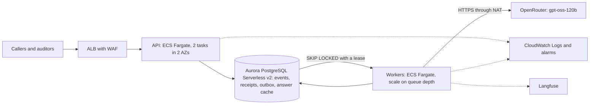

# AWS design: the validator as a small, authenticated service

On paper only: nothing here is deployed. It sizes the service built in iterations 3 and 4 (an API,
a worker and a database) for about **50,000 receipts a day**, and answers the five questions of
the brief's Part 4. Prices are AWS list prices, US East (N. Virginia), read from the AWS pricing
pages on 2026-10-11.

## 1. Architecture

- **API and compute: ECS Fargate**, stateless, behind an Application Load Balancer. A worker holds
  a database connection and makes 1 to 4 second model calls; Lambda would need a VPC, a NAT and a
  connection proxy for that, so Fargate is simpler at this size. The worker scales on the number of
  pending items in the outbox (a custom metric).
- **Database: Aurora PostgreSQL Serverless v2, Multi-AZ.** The system's correctness rests on one
  transaction (event, projection and outbox row commit together) and on leased claims
  (`SELECT … FOR UPDATE SKIP LOCKED`). Postgres keeps both, so the move is one adapter behind the
  `ReceiptStore` port, with the same contract tests as SQLite. DynamoDB with SQS would also work
  but would have to rebuild that transaction; at 0.6 receipts a second it buys nothing yet. The
  classification cache moves from a file to a table keyed by the same hash.
- **Logs:** structured JSON to CloudWatch Logs with alarms on queue depth, failed receipts and
  model errors. Model calls stay traced in Langfuse; Langfuse never gates a request.

## 2. The policy documents

The nine documents are **code with tests**: every rule cites its policy sentence verbatim and a
test checks it. A policy update is a pull request, CI (unit, determinism and verbatim-evidence
tests), an image build and a rolling deployment. Every result records `rules_version`, so old
decisions stay explainable. A versioned S3 bucket archives each release's policy bundle for audit;
it is not read at run time, because rule code and policy text must change together.

## 3. Authentication and secrets

**Cognito**: auditors and Compliance sign in through the company identity provider (SAML or OIDC);
calling systems use client-credentials tokens. The API validates the JWT and takes the reviewer from
the token, not from free text (today's `actor`), with scopes for intake and for review actions.
**Secrets Manager** holds the OpenRouter key and the database credentials, injected into the task at
start through the task role. Neither enters the image, the repository or the logs (a pre-commit
hook blocks key patterns and failure reasons are scrubbed).

## 4. Cost at about 50,000 receipts a day

1.5 million receipts a month; 2.47 line items per receipt (79 lines in 32 receipts) gives 3.70
million items a month. Every figure below is arithmetic on a stated price or an assumption.

| Line | Arithmetic | USD a month |
|---|---|---|
| Model calls | 3.70 M items × 0.060824 per 1,000 (measured on the dev set, gpt-oss-120b); upper bound, no cache hits | 225 |
| Aurora compute | 2 ACU on average (writer about 1.5, reader 0.5) × 730 h × 0.12 | 175 |
| Aurora storage and I/O | 100 GB average (11 KB a receipt, measured) × 0.10, plus 150 M I/O × 0.20 per million (100 per receipt, assumed) | 40 |
| Fargate, API | 2 tasks × (0.5 vCPU × 0.0404784 + 1 GB × 0.004446) × 730 h | 36 |
| Fargate, workers | 5 tasks on average × (0.25 vCPU × 0.0404784 + 0.5 GB × 0.004446) × 730 h. A receipt takes about 3.7 s of classification, so 0.58 receipts a second keeps about 2 tasks busy and a 10× peak about 21 | 45 |
| Load balancer | 730 h × 0.0225, plus 1 LCU × 730 h × 0.008 | 22 |
| NAT gateway | 730 h × 0.045, plus about 11 GB × 0.045 (price from AWS's example for another US region) | 33 |
| Cognito | Employees inside the 10,000 free MAU; 10 systems × 24 tokens × 30 days × 0.00225 per token | 16 |
| Logs and secrets | 20 GB ingested × 0.50 (assumed volume), 0.60 storage; 2 secrets × 0.40 | 12 |
| **Total** | about USD 0.0004 a receipt | **≈ 605** |

Not included: Langfuse hosting, WAF rules, data transfer to users, a support plan and a
non-production environment. The model is 37 % of the total, and any cache hit lowers it. The
I/O line and the log volume are assumptions to measure first.

## 5. Before real receipts go through it

1. **Model outage and retries.** Today a provider failure leaves the receipt `failed` and a person
   calls retry. Add automatic retries with backoff, a dead-letter alarm, and a fallback model;
   load-test against the provider's rate limits.
2. **Personal data.** Encrypt at rest (KMS) and in transit, define retention and deletion for
   employee identifiers, give access by role with an audit log, and keep personal data out of logs
   and traces.
3. **Recipient abuse (ADR 0001, Q3).** A gift or a restricted item can be justified by what the
   line text says about its recipient ("for a client"), which anyone can type. Verify named
   recipients against a CRM, raise a review signal when a restricted item is justified only by
   recipient text, track gift patterns per employee, and sample approved gifts.

## Candidates L1 to L8 in production

| | In production |
|---|---|
| L1 queue | Built as an outbox with leases; `SKIP LOCKED` on Aurora, or SQS with a dead-letter queue when decoupling pays |
| L2 authentication | Cognito, section 3 |
| L3 UI | The React front end of iteration 4, served behind the same load balancer |
| L4 overrides | Reviewer actions with `auditor_agreement` scores, built; roles come from Cognito |
| L5 versioned policies | A policy change is a deployment with tests; `rules_version` on every result |
| L6 timing rules | TIME-01 to TIME-04 reuse the cross-receipt grouping keys (`domain/cascade.py`) |
| L7 non-model observability | CloudWatch metrics for the engine and the queue; sampled Langfuse spans (needs an ADR) |
| L8 recipient abuse | Section 5, item 3 |
